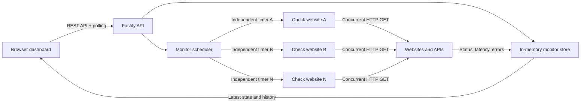

# Uptime Monitor

A practical multi-site uptime monitor built with Node.js, TypeScript, Fastify, and a vanilla JavaScript dashboard. Add several websites or APIs and checks them concurrently, each on its own independent schedule.

No database, account, or external monitoring service is required.

## Features

- Monitor multiple websites and APIs at the same time
- Independent check interval for each monitor
- Live online, offline, checking, and pending states
- Average successful response time, total failed-check count, and last-check information
- Total errors include HTTP errors, connection failures, and request timeouts
- Total elapsed monitoring time for each website
- Bounded response-time history for each website
- Manual checks and monitor removal
- Request timeouts and overlapping-check prevention
- Built-in healthy, slow, and failing demo endpoints
- Responsive dashboard, automated tests, and Docker support

## Quick start

### Run with Node.js

Requires Node.js 24.22.1 or newer. This baseline includes the October 2026 Node.js security fixes.

```bash
npm install
npm run dev
```

Open [http://localhost:3000](http://localhost:3000).

To use another host or port:

```bash
npm run dev -- --host 0.0.0.0 --port 7100
```

### Run with Docker

```bash
docker compose up --build
```

Open [http://localhost:3000](http://localhost:3000). Stop with `Ctrl+C`, then run `docker compose down`.

## Demonstration

1. Select **Healthy site**, **Slow site**, and **Failing site** under **Try a demo**.
2. Creates three monitors and starts their HTTP requests immediately.
3. The healthy and slow sites become `up`. The failing site returns HTTP 503 and becomes `down`.
4. Watch their independent checks repeat every 10 seconds.
5. Compare response times, status codes, errors, and history bars.
6. Select **Check now** to run a manual check or **Remove** to stop a monitor.

You can also add real HTTP or HTTPS websites through the form. All targets are checked concurrently. A slow website does not prevent other websites from being checked.

## How concurrent monitoring works

Each monitor has its own `setInterval` timer. When a timer fires, the checker starts an asynchronous HTTP request. Requests for different monitors can be in flight at the same time.

A per-monitor active flag prevents overlapping requests for the same URL. If a website is slow, its next scheduled check is skipped until the current request finishes. Other monitors continue normally.



The standalone diagram source is in `docs/architecture.mmd`.

## API

| Method | Endpoint | Description |
| --- | --- | --- |
| `GET` | `/health` | Application health check |
| `GET` | `/api/monitors` | List all monitors and their history |
| `POST` | `/api/monitors` | Add a monitor and start checking immediately |
| `POST` | `/api/monitors/:id/check` | Run a manual check |
| `DELETE` | `/api/monitors/:id` | Stop and remove a monitor |
| `GET` | `/demo/healthy` | Built-in healthy target |
| `GET` | `/demo/slow` | Healthy target with a 1.2-second delay |
| `GET` | `/demo/failing` | Target that returns HTTP 503 |

Create a monitor:

```bash
curl -X POST http://localhost:3000/api/monitors \
  -H 'Content-Type: application/json' \
  -d '{"name":"Example API","url":"https://example.com","intervalSeconds":30}'
```

`intervalSeconds` must be an integer from 5 to 3600.

## Configuration

| Environment variable | Default | Purpose |
| --- | --- | --- |
| `PORT` | `3000` | HTTP listening port |
| `HOST` | `0.0.0.0` | HTTP listening address |
| `REQUEST_TIMEOUT_MS` | `5000` | Timeout for each target request |
| `MAX_HISTORY` | `30` | Check results retained per monitor |
| `MAX_MONITORS` | `100` | Maximum simultaneous monitors |

## Design decisions and limitations

- **In-memory storage:** keeps setup simple. Monitors and history are lost on restart.
- **Independent timers:** allow each website to use a different interval while requests run concurrently.
- **Bounded history:** limits memory usage by retaining only recent results per monitor.
- **Single process:** suitable for local use and small demonstrations. It does not coordinate checks across multiple replicas.
- **No notifications:** email, Slack, and incident escalation are intentionally outside the project scope.
- **Target validation:** only HTTP and HTTPS URLs are accepted. A public deployment should also block private addresses and apply target allowlists to reduce SSRF risk.

A production monitoring service would add durable configuration, authentication, alerting, distributed scheduling, and checks from multiple geographic regions.

## Verification

```bash
npm run typecheck
npm test
npm run build
npm start
```

Tests cover concurrent checks across multiple sites, HTTP failure handling, manual checks, bounded history, monitor limits, input validation, removal, health checks, and dashboard serving.

## Project structure

```text
src/
  app.ts          Fastify routes and application setup
  checker.ts      Independent schedules and concurrent HTTP checks
  server.ts       Process entry point
  store.ts        In-memory monitors and bounded history
  types.ts        Shared domain types
public/
  index.html      Dashboard structure
  styles.css      Responsive visual design
  app.js          Dashboard state and API interaction
tests/            Unit and API integration tests
docs/             Architecture diagram source
Dockerfile        Multi-stage production image
compose.yaml      One-command container setup
```

## AI-assisted workflow

- **Tool used:** Kimi, directed through scoped implementation and review tasks.
- **Approximate initial implementation time:** one focused 30-minute session, followed by human review and customization.
- **Key steps:** define the monitor model, implement independent timers, prevent overlapping checks, add bounded history, build the dashboard, create reliable demo targets, and test concurrent behavior.
- **How output was checked:** strict TypeScript compilation, unit and API tests, a production build, and a live multi-site smoke test.